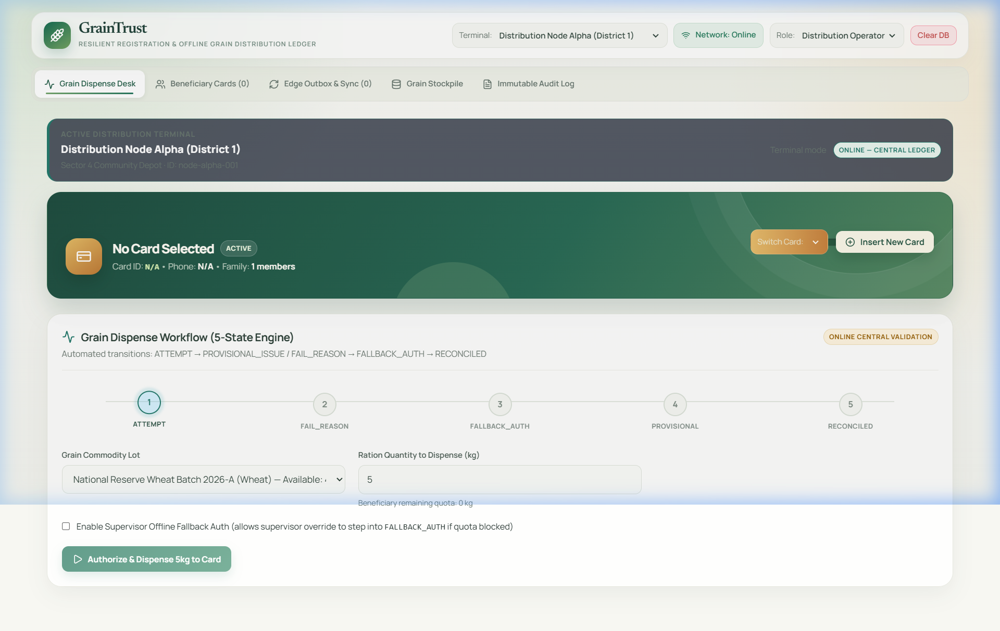
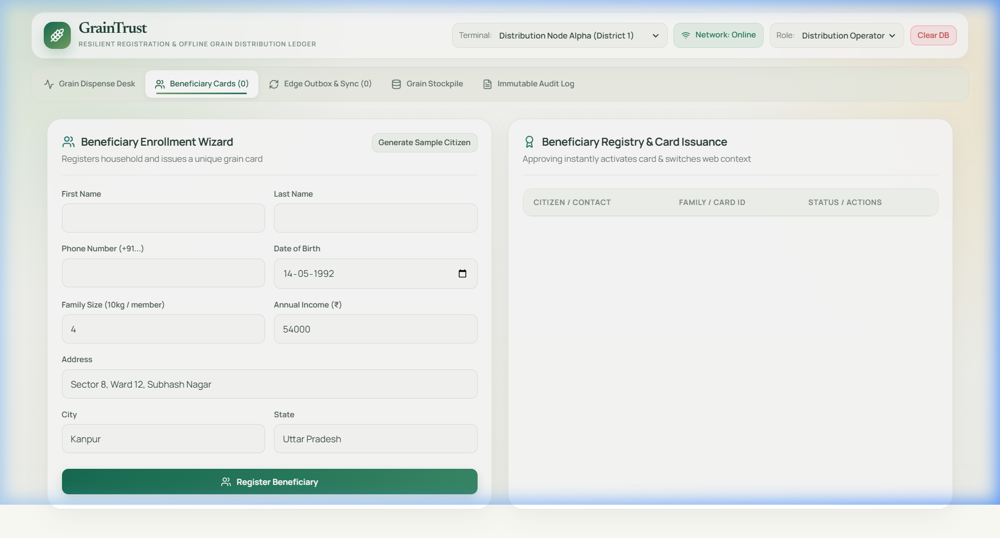
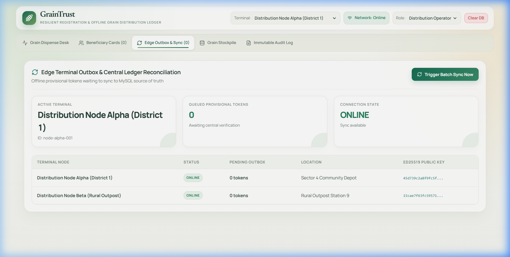
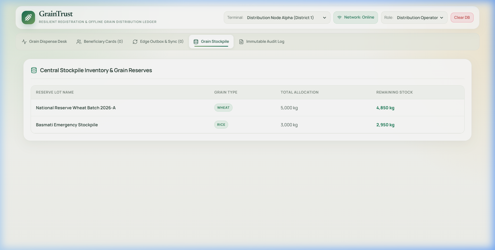
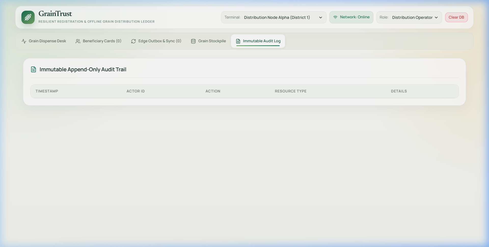
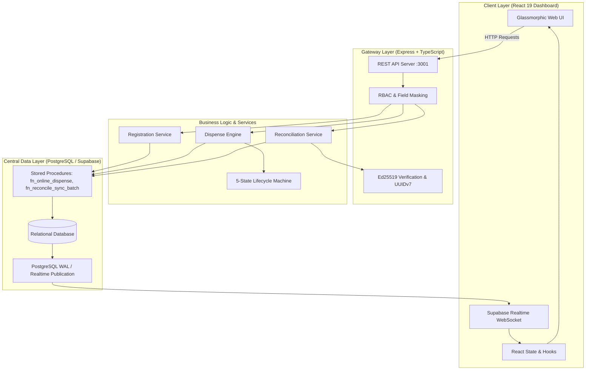

# 🌾 RationSafe Web Dashboard & Central Node API

[](LICENSE)
[](https://react.dev)
[](https://www.typescriptlang.org)
[](https://vitejs.dev)
[](src/client/local-storage-db.ts)
[-3ECF8E?logo=supabase&logoColor=white)](https://supabase.com)
[](src/tests/system.test.ts)

> **RationSafe Autonomous Public Distribution System (PDS) Web Administration Dashboard and Node.js REST API**, engineered for mission-critical grain rationing, cryptographic offline-first reconciliation, autonomous persistent client-side JSON ledger storage, and optional real-time Supabase cloud synchronization.

---

## 📸 Web Application Screenshots

### 1. Grain Dispense Desk & 5-State Engine

*Interactive Ration Card selector, household quota gauge, lot picker, stepper quantity adjustments, supervisor fallback override, and 5-state lifecycle stepper (`ATTEMPT` $\to$ `RECONCILED`).*

### 2. Citizen Ration Enrollment & Card Registry

*Citizen enrollment form with instant demographic validation, 1-click sample citizen generator, and card issuance registry.*

### 3. Edge Terminal Outbox & Central Ledger Synchronization

*Real-time monitoring of distribution nodes, outbox queue depths, and Ed25519 public key fingerprints.*

### 4. Central Grain Stockpile & Government Reserves

*National reserve warehouse inventory tracking remaining allocations for Premium Sharbati Wheat and Sona Masoori Rice.*

### 5. Immutable Append-Only Audit Trail

*Cryptographic append-only ledger capturing actor IDs, timestamps, resource mutations, and signed transaction metadata.*

---

## 🏛️ Website Workflow & Data Flow Architecture

The GrainTrust Web application functions as both an interactive administrative dashboard and the central synchronization gateway for physical distribution nodes and mobile terminals.

### 🔄 End-to-End System Workflow



---

## 📊 Detailed Data Flows

### 1. Beneficiary Registration Flow
1. **Application Submission**: An applicant submits demographic and KYC details (Name, Aadhaar/ID hash, Family Members, Income) through the Web Portal.
2. **Field Masking & Privacy**: The server computes a privacy-preserving SHA-256 hash of the sensitive citizen data and generates a deterministic **UUIDv7** primary key (time-ordered).
3. **Approval & Quota Ledger**: When the Supervisor or Admin approves the application, the database atomically:
   - Sets registration status to `APPROVED`.
   - Creates an active `Card` record.
   - Computes household grain quota based on family size (e.g., $4 \text{ members} \times 5\text{ kg} = 20\text{ kg/month}$).
   - Initializes a fresh monthly `CardQuotaLedger`.

### 2. Real-Time Online Dispense Flow
1. **Card & Lot Selection**: The operator chooses the beneficiary ration card and the depot's active stockpile lot (e.g., `LOT-WHEAT-2026-01`).
2. **Quota Pre-Flight**: The frontend validates that `requested_quantity <= remaining_quota` and verifies lot availability.
3. **Atomic RPC Execution**: A request is dispatched to `/api/v1/dispense` or directly to Supabase RPC `fn_online_dispense()`:
   - Acquires a row lock on `card_quota_ledger` to prevent double-spending race conditions.
   - Decrements `remaining_quota` in `card_quota_ledger`.
   - Decrements `remaining_quantity` in `lots`.
   - Appends an immutable `DistributionTransaction` record with state `RECONCILED`.
   - Appends an entry into `audit_events`.
4. **WebSocket Broadcast**: Supabase Realtime streams the mutation to all connected Web and Mobile terminals within ~50ms.

### 3. 5-Stage Transaction Lifecycle State Machine
Every distribution operation strictly follows a deterministic 5-stage state machine:

```
[ATTEMPT] ──> [FAIL_REASON] ──> [FALLBACK_AUTH] ──> [PROVISIONAL] ──> [RECONCILED]
```
- **`ATTEMPT`**: The initial transaction request is constructed.
- **`FAIL_REASON`**: If biometric or online verification fails, the specific failure reason is logged (`ERR_101: Biometric Mismatch`, `ERR_202: Offline Timeout`).
- **`FALLBACK_AUTH`**: Supervisor enters an emergency authorization override.
- **`PROVISIONAL`**: A cryptographically signed offline Ed25519 token is issued to the citizen with an offline QR receipt.
- **`RECONCILED`**: The batch is synchronized and verified centrally, finalizing ledger state.

### 4. Cryptographic Edge Synchronization Flow
Distribution nodes operate autonomously in remote environments with zero internet connectivity:
1. **Local Signing**: The depot node signs an Ed25519 token using its private key over canonical, deterministic JSON:
   $$\text{Signature} = \text{Sign}_{\text{Ed25519}}(H(\text{Canonical}(\text{Token})))$$
2. **Outbox Queue**: The token is queued in the node's local storage with an incremented monotonic counter.
3. **Batch Sync Dispatch**: When connectivity is restored, the node posts the outbox batch to `/api/v1/sync/batch` or Supabase RPC `fn_reconcile_sync_batch()`.
4. **Central Verification**:
   - The central engine checks the node's registered Ed25519 public key.
   - Verifies cryptographic signature validity.
   - Enforces nonce uniqueness to prevent replay attacks.
   - Atomically deducts quotas and transitions token state to `RECONCILED`.

---

## 🛠️ Technology Stack

| Layer | Technology |
|---|---|
| **Frontend Framework** | React 19, TypeScript, Vite |
| **Primary Data Engine** | Autonomous Client-Side JSON Database Engine (`localStorage` + Edge Cache, zero setup) |
| **Cloud Synchronization** | Supabase (PostgreSQL 15), Supabase Realtime, Row-Level Security (Optional) |
| **Styling & UI** | Cyber-Glassmorphism Dark Theme (`#0A0E17`, `#0F172A`), Vanilla CSS, Lucide Icons |
| **Backend API Server** | Node.js, Express 5, TypeScript (`tsx`) |
| **Cryptography** | `@noble/ed25519`, TweetNaCl, SHA-256 privacy hashing |
| **Testing** | Standalone TypeScript system test suite (20 comprehensive scenarios) |

---

## 🚀 Setup & Installation Guide

### Prerequisites
- Node.js (v18 or higher recommended)
- npm or pnpm

### 1. Clone & Install Dependencies
```bash
git clone https://github.com/unknownYT500/rationsafe_webapp.git
cd rationsafe_webapp
npm install
```

### 2. Configure Environment Variables & Supabase
Copy the template `.env.example` to `.env`:
```bash
cp .env.example .env
```
Update `.env` with your Supabase project credentials:
```env
# Supabase Cloud Configuration
VITE_SUPABASE_URL=https://<your-project-ref>.supabase.co
VITE_SUPABASE_ANON_KEY=<your-anon-key>
SUPABASE_SERVICE_ROLE_KEY=<your-service-role-key>

# API Server Configuration
PORT=3001
HOST=0.0.0.0
NODE_ENV=development
```

Verify your Supabase connection and tables with 1 command:
```bash
npm run test:supabase
```
*(For complete step-by-step SQL migration instructions, refer to [SUPABASE_SETUP_GUIDE.md](SUPABASE_SETUP_GUIDE.md)).*

### 3. Run Development Servers
Open two terminal windows:

```bash
# Terminal 1: Launch Central Node REST API Server
npm run start:api
# Output: Grain Distribution API running on http://localhost:3001

# Terminal 2: Launch Vite Web Dashboard
npm run dev
# Output: Local: http://localhost:3000/ (or http://localhost:5173/)
```

### 4. Run System Verification Tests
The repository includes a comprehensive 20-scenario system test suite:
```bash
npm test
```
**Test Coverage Includes:**
- UUIDv7 uniqueness and ordering under high concurrency (1,000 parallel registrations)
- Field masking and strict RBAC enforcement
- State machine transition invariants
- Cryptographic Ed25519 token tampering detection
- Replay attack rejection & idempotency caching
- Monotonic counter recovery across node restarts
- High-concurrency quota depletion race condition resolution

### 5. Production Build
```bash
npm run build
npm run preview
```

---

## 📦 GitHub Repository

```bash
git remote add origin https://github.com/unknownYT500/rationsafe_webapp.git
git branch -M main
git push -u origin main
```

